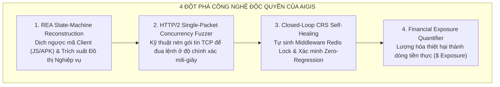
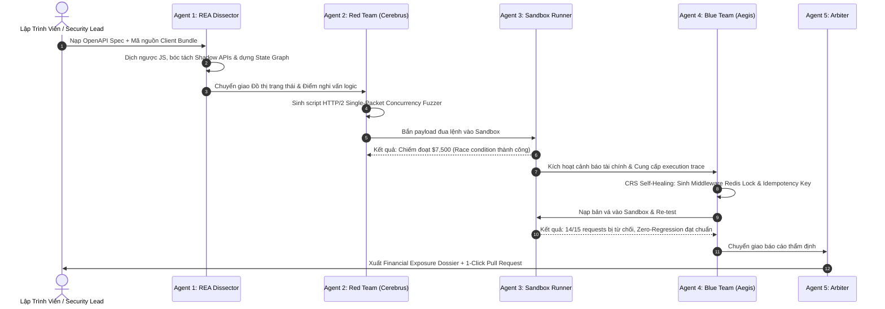

# 🛡️ AIGIS — Adversarial Intelligence for Generative Immunity & Security
**Đặc tả Kiến trúc Hệ thống & Đột Phá Công Nghệ (System Architecture & Technical Specification)**

> [!IMPORTANT]
> **Tuyên ngôn Dự án (Project Mission):**
> $$\mathbf{A} \cdot \mathbf{I} \cdot \mathbf{G} \cdot \mathbf{I} \cdot \mathbf{S}$$
> * **A** — **A**dversarial *(Tác chiến Đối kháng / Red Teaming)*
> * **I** — **I**ntelligence for *(Hệ điều phối Đa Agent Thông minh)*
> * **G** — **G**enerative *(Tự sinh Đòn Tấn công & Tự sinh Bản vá)*
> * **I** — **I**mmunity & *(Cơ chế Tự sinh Miễn dịch Số / Self-Healing)*
> * **S** — **S**ecurity *(Bảo vệ Toàn diện Logic Nghiệp vụ FinTech)*
>
> **Câu Pitch 30 giây (Elevator Pitch):**
> *"Kẻ gian trong tài chính và thương mại điện tử không cần hack server — họ hack **Logic Nghiệp vụ (Business Logic)**. Họ tạo đua lệnh rút tiền, nhảy cóc bước thanh toán, hoặc lợi dụng sơ hở client để bòn rút sạch ngân sách khuyến mãi. Các công cụ DAST/SAST truyền thống hoàn toàn 'mù' trước lỗi logic này. **AIGIS** là nền tảng Đấu trường Đối kháng Tự hành đầu tiên trên thế giới: tự động dịch ngược mã nguồn client/API để vẽ lại bản đồ nghiệp vụ, thả **Hacker AI (Red Team)** vào tấn công tìm kẽ hở bòn rút tiền trong Sandbox, và điều phối **Defender AI (Blue Team)** tự sinh mã vá lỗi trước khi tính năng kịp lên Production."*

---

## 1. Vấn Đề Cốt Lõi: "Điểm Mù Triệu Đô" Của Ngành Bảo Mật

### 1.1. Lỗ Hổng Logic Nghiệp Vụ (Business Logic Vulnerabilities - BLVs)
Khác với các lỗi kỹ thuật thông thường (như SQL Injection, Buffer Overflow hay XSS), **Lỗ hổng Logic** xảy ra khi hệ thống phần mềm chạy *hoàn toàn đúng cú pháp code*, nhưng chuỗi hành vi của người dùng phá vỡ mục đích kinh tế của doanh nghiệp:
* **Race Condition (Đua số dư ví):** Gửi đồng thời 20 request đổi mã quà tặng trong cùng 1 mili-giây trước khi cơ sở dữ liệu kịp khóa bản ghi.
* **State-Machine Bypass (Nhảy cóc trạng thái):** Gọi thẳng API xác nhận đơn hàng mà bỏ qua bước trừ tiền hoặc bước xác thực OTP.
* **Voucher Looping & Threshold Manipulation:** Lợi dụng logic hoàn tiền để nhân bản mã ưu đãi hoặc bơm số âm/thập phân vô hạn vào giỏ hàng.

### 1.2. Tại sao các công cụ hiện nay thất bại?
* Các công cụ quét tĩnh/động (SAST/DAST) hiện nay chỉ phân tích cú pháp mã hoặc tìm lỗ hổng CVE đã biết. Chúng **không có khả năng hiểu ngữ cảnh kinh doanh**: chúng không biết 1 voucher giảm 50% chỉ được dùng một lần cho một khách hàng.
* Thuê chuyên gia Red Team con người kiểm thử thâm nhập (Pen-test) thì cực kỳ đắt đỏ (`\$30,000–\$100,000`), tốn 3–4 tuần và hoàn toàn không theo kịp chu kỳ release tính năng liên tục hàng tuần của các sàn TMĐT.

---

## 2. Bốn Trụ Cột Đột Phá Công Nghệ Của AIGIS

AIGIS giải quyết bài toán trên bằng 4 sáng kiến công nghệ độc quyền được tích hợp thành một vòng lặp khép kín:



### 2.1. REA State-Machine Reconstruction (Tái Tạo Máy Trạng Thái Bằng Dịch Ngược)
Lập trình viên thường mắc sai lầm chí mạng: **chỉ kiểm tra điều kiện ở client** (vô hiệu hóa nút bấm bằng Javascript, kiểm tra hạn mức bằng code frontend) mà quên kiểm tra ở API backend, hoặc vô tình để lộ các API thử nghiệm (Shadow APIs) trong file bundle.
* AIGIS trang bị bộ công cụ dịch ngược **REA (Reverse Engineering & Extraction)**:
  * Phân tích tĩnh gói mã nguồn frontend (JavaScript bundle, React Native, Android APK).
  * Khai quật toàn bộ endpoint ẩn chưa từng được công bố trong tài liệu API Swagger.
  * Tự động dựng lại **Đồ thị Máy Trạng thái Nghiệp vụ (State Machine Graph)**: từ `Khởi tạo giỏ hàng` $\rightarrow$ `Áp mã giảm giá` $\rightarrow$ `Thanh toán` $\rightarrow$ `Xác nhận giao dịch`.

### 2.2. HTTP/2 Single-Packet Concurrency Fuzzer (Đua Lệnh Nén Gói Tin Độc Quyền)
Trong môi trường mạng thực tế, các cuộc tấn công đua lệnh (Race Condition) rất dễ trượt do độ trễ mạng ngẫu nhiên (Network Jitter) làm các request đến server lệch nhau vài mili-giây.
* AIGIS phát triển cơ chế **Single-Packet Synchronization**:
  * Gom 20–30 request HTTP/2 độc lập vào **duy nhất một khung TCP**.
  * Toàn bộ các request này chạm tới tầng mạng của server tại **cùng một mili-giây ($t_0$)**.
  * Bóc trần hoàn toàn các lỗ hổng thiếu khóa nguyên tử (Atomic Lock / Idempotency Key) trong microservices.

### 2.3. Closed-Loop CRS Self-Healing (Tự Động Vá Lỗi Khép Kín)
AIGIS không chỉ dừng lại ở việc đưa ra cảnh báo hay báo cáo dạng chữ mà con người phải đọc:
* Agent Blue Team phân tích cú pháp AST của backend mục tiêu.
* Tự động tổng hợp đoạn mã **Middleware phòng hộ (Idempotency Guard / Distributed Redis Lock)**.
* Tự động cài bản vá vào môi trường Sandbox, sau đó kích hoạt lại bài tấn công cũ để xác nhận: **100% đòn tấn công đã bị vô hiệu hóa**.
* Tự động chạy bài kiểm tra **Zero-Regression**: Giả lập 100 khách hàng bình thường để chứng minh độ trễ chỉ tăng $\le 2\text{ms}$ và không có giao dịch hợp lệ nào bị chặn nhầm.

### 2.4. Financial Exposure Quantifier (Định Giá Thiệt Hại Dòng Tiền)
Thay vì xếp hạng rủi ro chung chung (Low, Medium, High), AIGIS quy đổi rủi ro thành **con số tiền mặt cụ thể**:
$$\text{Financial Exposure} = \Delta \text{Vouchers / Cash Withdrawn} \times \text{Unit Value} \times \text{Expected Attack Velocity}$$
Giúp ban lãnh đạo và giám đốc tài chính nhìn thấy ngay con số thiệt hại được cứu vãn tính bằng USD.

---

## 3. Kiến Trúc Đấu Trường Đối Kháng 5 Agents



### ① Agent 1: REA Dissector (Trinh Sát Dịch Ngược)
* **Nhiệm vụ:** Quét toàn diện mã nguồn client và tài liệu API.
* **Đầu ra:** Bản đồ State Machine nghiệp vụ, danh sách Shadow Endpoints và các lỗ hổng do tin tưởng client-side validation.

### ② Agent 2: Red Team — "Cerebrus" (Hacker AI Thực Chiến)
* **Nhiệm vụ:** Suy nghĩ như kẻ gian, tự động viết script Python khai thác:
  * *Concurrency Fuzzer:* Đua lệnh nhận quà/rút tiền qua cơ chế Single-Packet.
  * *State Bypass:* Bỏ qua bước thanh toán gọi thẳng confirm.
  * *Boundary Injection:* Thử nghiệm số âm và số thập phân tràn giới hạn.
* **Đầu ra:** Script Python khai thác hoàn chỉnh (`exploit_poc.py`).

### ③ Agent 3: Sandbox Runner (Võ Đài Thực Thi Cô Lập)
* **Nhiệm vụ:** Chạy script tấn công trong môi trường container giả lập kết nối DB test.
* **Đo lường:** Ghi nhận mã phản hồi HTTP, số lượng giao dịch lậu thành công, và tính toán số tiền bị chiếm đoạt thực tế.

### ④ Agent 4: Blue Team — "Aegis" (Người Bảo Hộ Tự Chữa Lành)
* **Nhiệm vụ:**
  * Giải mã nguyên nhân gốc rễ (Root Cause Analysis).
  * Tự động sinh mã nguồn Middleware vá lỗi (Redis Lock / Idempotency Key).
  * Nạp bản vá vào backend và chạy lại đòn tấn công để chứng minh lỗi đã biến mất.
  * Đo lường hiệu năng của khách hàng thật để bảo đảm không gây nghẽn hệ thống.

### ⑤ Agent 5: Arbiter (Trọng Tài Đấu Trường)
* **Nhiệm vụ:**
  * Chấm điểm an toàn Logic Security Score (0–100).
  * Xuất bản **Hồ sơ Rủi ro Tài chính (Financial Exposure Dossier)**.
  * Tự động tạo **GitHub Pull Request** với đầy đủ code vá lỗi và unit test.

---

## 4. Cấu Trúc Mã Nguồn MVP

```
aigis/
├── backend/
│   ├── server.py              # FastAPI server điều phối Wargame
│   ├── agents/
│   │   ├── rea_dissector.py   # Agent 1: Bóc tách mã client & dựng State Graph
│   │   ├── red_cerebrus.py    # Agent 2: Sinh script HTTP/2 Single-Packet Attack
│   │   ├── sandbox_runner.py  # Agent 3: Thực thi exploit và đo lường tiền mất
│   │   ├── blue_aegis.py      # Agent 4: Tự sinh Redis Idempotency Patch
│   │   └── arbiter.py         # Agent 5: Tính điểm ROI & xuất PR GitHub
│   └── target_mock/           # Ứng dụng thanh toán test có sẵn lỗi logic
│       ├── app.py             # Endpoint /api/v1/voucher/claim (dính race condition)
│       └── checkout.js        # File client mẫu để REA bóc tách
└── frontend/                  # Giao diện Wargame Split-Screen
    ├── src/
    │   ├── components/
    │   │   ├── RedTeamColumn.jsx   # Cột đỏ: Log REA, code exploit Python
    │   │   ├── BlueTeamColumn.jsx  # Cột xanh: Code vá lỗi, Zero-regression test
    │   │   └── DossierModal.jsx    # Báo cáo thiệt hại & nút 1-Click PR
```

---

## 5. Kịch Bản Thuyết Trình Sân Khấu 3 Phút (Hackathon Winning Pitch)

* **0:00 – 0:30 (Mở đầu & Đặt vấn đề):** Nêu bật hiểm họa mất tiền triệu đô từ lỗ hổng logic nghiệp vụ mà các tool quét virus thông thường không thể thấy. Giới thiệu AIGIS.
* **0:30 – 1:15 (Cảnh 1 - REA & Red Team):** Kéo thả code client vào giao diện $\rightarrow$ REA bóc trần sơ hở $\rightarrow$ Red Team tự viết Python nén 15 request vào 1 khung TCP bắn đua lệnh $\rightarrow$ Chiếm đoạt ngay \$7,500 trên màn hình.
* **1:15 – 2:15 (Cảnh 2 - Blue Team Tự Vá):** Blue Team bừng sáng, tự động phân tích nguyên nhân $\rightarrow$ Tự sinh Middleware Redis Lock vá lỗi $\rightarrow$ Chạy lại đợt tấn công cũ: 14 request bị chặn đứng $\rightarrow$ Kiểm tra khách thật: thời gian phản hồi chỉ tăng 1.8ms.
* **2:15 – 3:00 (Cảnh 3 - Hạ Màn & ROI):** Xuất Financial Exposure Dossier (Ngăn chặn thất thoát \$150,000) kèm nút bấm 1-Click đẩy Pull Request lên GitHub.
