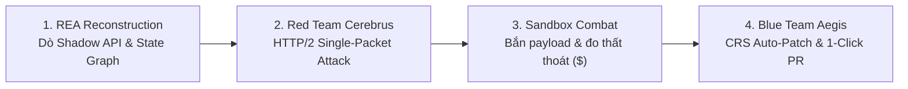

# 🛡️ AIGIS — Bản Tóm Tắt Dự Án (Mini Hackathon One-Pager)
**AIGIS: Adversarial Intelligence for Generative Immunity & Security**

> [!IMPORTANT]
> **Định nghĩa Tên gọi Chuẩn xác (Exact Acronym):**
> $$\mathbf{A} \cdot \mathbf{I} \cdot \mathbf{G} \cdot \mathbf{I} \cdot \mathbf{S}$$
> * **A** — **A**dversarial *(Tác chiến Đối kháng / Red Teaming)*
> * **I** — **I**ntelligence for *(Hệ điều phối Đa Agent Thông minh)*
> * **G** — **G**enerative *(Tự sinh Đòn Tấn công & Tự sinh Bản vá)*
> * **I** — **I**mmunity & *(Cơ chế Tự sinh Miễn dịch Số / Self-Healing)*
> * **S** — **S**ecurity *(Bảo vệ Toàn diện Logic Nghiệp vụ FinTech)*
>
> **Pitch 30 giây:**
> *"Kẻ gian trong FinTech và TMĐT không cần hack server — họ hack **Logic Nghiệp vụ (Business Logic)**: dùng kỹ thuật đua gói tin để rút tiền gấp 20 lần trong 1 mili-giây, hoặc bóc tách client để tìm endpoint ẩn trục lợi voucher. Các công cụ DAST/SAST thông thường hoàn toàn 'mù' trước lỗi logic này. **AIGIS** (Adversarial Intelligence for Generative Immunity & Security) là nền tảng Đấu trường Đối kháng Tự hành đầu tiên: sử dụng công nghệ dịch ngược **REA** để bóc tách mã nguồn client/API, thả **Hacker AI (Red Team)** vào tự tấn công bòn rút tiền trong Sandbox, và điều phối **Defender AI (Blue Team)** tự sinh mã vá lỗi trước khi tính năng lên Production."*

---

## 1. Cơ Chế Hoạt Động 4 Bước (The Wargame Loop)

1. **REA State Reconstruction:** Nạp tài liệu API và mã nguồn Client JS/APK $\rightarrow$ Bộ giải mã REA bóc trần toàn bộ Shadow APIs ẩn và tự động dựng lại Đồ thị Trạng thái giao dịch (Business State Machine Graph).
2. **Red Team Single-Packet Fuzzer:** Agent *Cerebrus* áp dụng cơ chế đồng bộ gói tin độc quyền, nén 20 requests vào 1 khung TCP HTTP/2 để triệt tiêu hoàn toàn độ trễ mạng, tạo đòn tấn công đua số dư (Race condition) chuẩn xác ở độ phân giải mili-giây.
3. **Sandbox Combat & Exposure Calc:** Chạy payload tấn công trong môi trường sandbox cô lập, đo lường chính xác số tiền thất thoát thực tế (ví dụ: *"Rút thành công \$7,500 từ 1 tài khoản test do thiếu Idempotency"*).
4. **Blue Team CRS Auto-Patch:** Agent *Aegis* tự động phân tích cú pháp AST, sinh mã Middleware phòng hộ (Redis Distributed Lock), chạy lại bài test để chứng minh lỗi đã biến mất mà không làm ảnh hưởng trải nghiệm khách hàng thật.

---

## 2. Đội Hình 5 AI Agents Trong AIGIS

| Agent | Tên gọi | Vai trò & Trọng trách chính |
| :--- | :--- | :--- |
| **Agent 1** | **REA Dissector** | Dịch ngược mã client, phát hiện logic kiểm tra sơ hở ở frontend và dựng State Machine Graph. |
| **Agent 2** | **Red Team "Cerebrus"** | Tự động sinh mã Python khai thác *HTTP/2 Single-Packet Attack* để đua lệnh và vượt rào trạng thái. |
| **Agent 3** | **Sandbox Runner** | Môi trường cô lập thực thi exploit, đo đếm số dư bị trừ và tính toán **Chỉ số Rủi ro Tài chính (\$ Exposure)**. |
| **Agent 4** | **Blue Team "Aegis"** | Tự động sinh mã vá (Redis Idempotency / State Token), tái kiểm thử zero-regression (độ trễ chỉ tăng $< 2\text{ms}$). |
| **Agent 5** | **Arbiter** | Chấm điểm an toàn (Security Score: 0–100), lập Financial Exposure Dossier và xuất **1-Click GitHub Pull Request**. |

---

## 3. Kịch Bản Demo 3 Phút Trên Sân Khấu

* **⏱️ 0:00 – 0:30 (Mở Đầu):** *"Kẻ gian vừa rút sạch \$200,000 ngân sách khuyến mãi Tết qua lỗi đua lệnh logic mà SonarQube hay Burp Suite đều bó tay. Giới thiệu **AIGIS** (Adversarial Intelligence for Generative Immunity & Security)."*
* **⏱️ 0:40 – 1:30 (Màn 1: REA & Red Team Tấn Công):**
  * Tải file `Tet_Voucher_API.json` và `checkout.js` lên giao diện $\rightarrow$ Bấm **`[⚔️ BẮT ĐẦU WARGAME]`**.
  * Cột trái (Đỏ) bừng sáng: REA tìm thấy hàm gọi API chưa khóa throttle $\rightarrow$ Red Agent tự viết Python bắn 15 request đồng thời trong 1 gói tin TCP.
  * Sandbox báo động đỏ: *"Khai thác thành công! Chiếm đoạt 15 voucher trị giá \$7,500!"*
* **⏱️ 1:30 – 2:30 (Màn 2: Blue Team Phản Công & Tự Sinh Bản Vá):**
  * Cột phải (Xanh) nhảy vào: Blue Agent phân tích nguyên nhân và tự tạo middleware **Redis Distributed Lock (Idempotency Key)**.
  * Chạy lại đợt tấn công cũ: 14 request sau lập tức bị từ chối với mã `429 Too Many Requests`.
  * Kiểm tra giao dịch khách thật: Thời gian phản hồi chỉ tăng 1.8ms, không gây phiền hà khách hàng.
* **⏱️ 2:30 – 3:00 (Màn 3: Báo Cáo Tài Chính & 1-Click GitHub PR):**
  * Bung thẻ **Financial Exposure Dossier**:
    * `Nguy cơ thất thoát đã triệt tiêu: $150,000/chiến dịch`.
    * `Điểm an toàn Logic: 32/100 -> 98/100`.
  * Bấm nút **[1-Click Create GitHub PR]** $\rightarrow$ Đoạn mã vá lỗi được gửi thẳng lên repo của team Dev.

---

## 4. Checklist Triển Khai MVP (24h – 48h)

- [ ] **1. Mock Target & Vulnerable Backend (FastAPI):**
  - Endpoint `/api/v1/voucher/claim` dính lỗi race condition.
  - File bundle `checkout.js` giả lập có hàm gọi API chưa khai báo trong Swagger.
- [ ] **2. Tầng REA & Red Team Agent:**
  - Agent đọc spec + phân tích endpoint bằng công cụ REA.
  - Red Agent sinh script Python HTTP/2 Single-Packet Attack bắn đồng thời 15-20 requests.
- [ ] **3. Sandbox Executor:**
  - Runner chạy script Python, ghi nhận HTTP Status và số dư ví/voucher trong DB test.
- [ ] **4. Blue Team Agent:**
  - Prompt sinh mã vá lỗi (middleware FastAPI với Redis lock).
  - Tự động mount middleware vào instance test và chạy lại test regression.
- [ ] **5. Giao diện Wargame Split-Screen (React):**
  - Màn hình chia đôi: Nửa đỏ (Red Team logs & exploit code) - Nửa xanh (Blue Team patch & regression test).
  - Thẻ kết quả: Financial Exposure Dossier + nút 1-Click PR.
