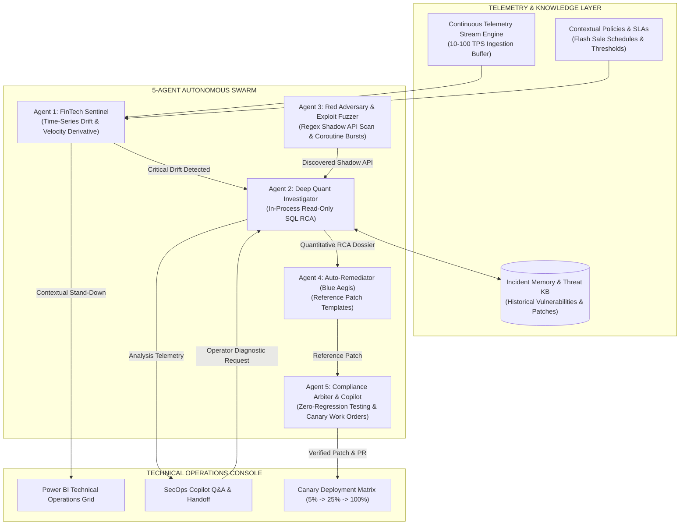

<div align="center">

# AIGIS: Adversarial Intelligence for Generative Immunity & Security

**Autonomous Multi-Agent Adversarial Wargaming & Self-Healing Architecture for FinTech Business Logic**

*Detecting, Exploiting, Diagnosing, and Auto-Patching Sub-5ms Concurrency Race Conditions & Business Logic Flaws in Real-Time*

<br/>

<p align="center">
  <a href="https://github.com/Faewon/AIGIS"></a>
  <a href="https://fastapi.tiangolo.com/"></a>
  <a href="https://www.python.org/"></a>
  <a href="https://www.sqlite.org/"></a>
  <a href="#"></a>
  <a href="LICENSE"></a>
</p>

</div>

---

> [!IMPORTANT]
> **THE 2026 FINTECH CRISIS: BUSINESS LOGIC VULNERABILITIES & SUB-5MS RACE CONDITIONS**
> 
> High-throughput financial services, digital wallets, and e-commerce platforms lose tens of millions annually not to traditional injection attacks (SQLi, XSS), but to **Time-of-Check to Time-of-Use (TOCTOU) concurrency race conditions**, undocumented **Shadow APIs** exposed in client bundles, and distributed **Sybil bot swarms**.
> 
> Static application security testing (SAST) and dynamic web vulnerability scanners (DAST) struggle with these temporal, multi-threaded business logic flaws. AIGIS is a **simulation demo**: a multi-agent arena that runs attacks, patches and retests against an **in-process mock target** and synthetic telemetry, to illustrate the workflow.

> [!WARNING]
> **Scope & limitations (read before relying on any number shown in the UI)**
> - All attacks, patches and benchmarks run against `backend/mock_target/store.py`, an in-process Python object. AIGIS cannot be pointed at a real service.
> - "HTTP/2 single-packet bursts" are `asyncio.gather` calls on local coroutines; no HTTP is sent.
> - The "distributed mutex" used in the mock is an in-process dict. Redis is only referenced in the *generated reference templates*, which are never executed.
> - "Applying a patch" flips feature flags on the mock target. Generated code is displayed for review only.
> - Shadow-API discovery is regex-based, not an AST analysis.
> - Scores, mitigation rates and losses are computed from the mock runs and labelled as demo heuristics. Compliance entries are demo mappings, not audit results.
> - The telemetry dataset is synthetic. The DB and CSV are not committed (they exceed GitHub limits); generate them from the UI (`/api/v1/dataset/generate`, then `/api/v1/database/sync`).

---

## Feature Overview (demo scope)

| Capability | What the code actually does |
| :--- | :--- |
| **TOCTOU race detection** | Fires N concurrent coroutines at the mock voucher store and counts duplicate successes. |
| **Concurrency gap measurement** | Computes per-user inter-arrival gaps from telemetry with parameterized, read-only SQL. Reports "no collisions" when none are found. |
| **Root cause analysis** | In-process SQL analysis. The displayed Python script is a read-only audit preview and is not executed. |
| **Patch synthesis** | Emits reference templates (SQL atomic claim, FastAPI, Spring, Gin, Cloudflare, NGINX, AWS WAF). Not executed. |
| **Canary rollout** | Preview only; stages are marked `SIMULATED_PENDING_APPROVAL`. |
| **Contextual stand-down** | Distinct-user ratio + proxy ratio heuristic, gated by the flash-sale policy's `active_from`/`active_to` window. |
| **Incident memory** | SQLite table; new incidents are only recorded when collisions are actually measured. |

---

## Core Capabilities Grid

| Time-Series Sentinel & Drift | In-Process RCA | Reference Patches | Demo Work Order |
| :--- | :--- | :--- | :--- |
| • Sliding window dTPS/dt<br/>• Linear tail forecast at t+15s, t+30s, t+60s<br/>• Contextual Stand-Down Filter<br/>• Sub-50ms collision clustering | • Parameterized read-only SQL<br/>• Inter-arrival gap calculation<br/>• "Insufficient data" instead of defaults<br/>• No code execution | • DB unique constraint + conditional UPDATE<br/>• Owner-token lock release templates<br/>• Identity from auth context, not headers<br/>• Not executed by AIGIS | • Demo mappings only (not assessed)<br/>• Measured mock-target regression check<br/>• 3-stage canary plan preview<br/>• Simulated PR text |

---

## System Architecture



---

## The 5-Agent Swarm Deep Dive

### 1. FinTech Sentinel: Time-Series Drift & Signal Tail Forecasting
FinTech Sentinel tracks live operational telemetry streams (10 to 100 TPS) across multiple sliding time windows (5s, 15s, 60s). Unlike basic threshold monitors, it computes the **velocity derivative**:

$$\frac{d\text{TPS}}{dt} = \frac{\text{TPS}_{t} - \text{TPS}_{t-\Delta t}}{\Delta t}$$

- **Signal Tail Forecasting**: Projects traffic volume at $t+15\text{s}$, $t+30\text{s}$, and $t+60\text{s}$ by linear extrapolation of the velocity derivative (TPS + t * dTPS/dt). Time to exhaustion:
  $$T_{\text{exhaust}} = \frac{\text{Remaining Budget}}{\text{Current Drain Velocity}}$$
- **Contextual Stand-Down Filter**: When transactions surge during an active promotion window (`active_from` <= now <= `active_to`), Sentinel computes the **distinct-user ratio** (unique users / events; not Shannon entropy). If it is >= 0.70, the datacenter-proxy ratio is <= 0.25 and no sub-50ms clusters are present, Sentinel triggers a **Stand-Down**.

### 2. Deep Quant Investigator: In-Process RCA
When an anomaly is flagged, the Investigator validates the endpoint against an allow-list pattern and computes metrics in-process with parameterized SQL over a `mode=ro` connection. No request data is turned into code, and nothing is executed in a subprocess. The UI shows an equivalent audit script for transparency:

```python
# Audit preview (displayed, not executed)
conn = sqlite3.connect(f"file:{db_path}?mode=ro", uri=True)
cur.execute("SELECT epoch_ms, user_id, status_code_unpatched FROM telemetry "
            "WHERE api_endpoint = ? ORDER BY epoch_ms ASC LIMIT 500", (endpoint,))
# ...per-user inter-arrival gaps; gap <= 50ms counts as a collision
```

- If no collisions are measured, the report says so and no incident is recorded. There are no hard-coded fallback numbers.

### 3. Red Adversary: Shadow API Discovery & Burst Simulation
- **Shadow API Discovery**: Regex scan of the bundled `checkout_bundle.js` for endpoint strings.
- **Concurrency burst**: `asyncio.gather` of N coroutine calls against the in-process mock store (no network I/O).

### 4. Auto-Remediator (Blue Aegis): Reference Patch Templates
The root-cause fix is database-level atomicity. A mutex only narrows the window:

```sql
ALTER TABLE voucher_claims ADD CONSTRAINT uq_voucher_claim_user UNIQUE (user_id, voucher_code);
BEGIN;
UPDATE voucher_campaigns SET budget_remaining = budget_remaining - $3
 WHERE voucher_code = $2 AND budget_remaining >= $3;      -- 0 rows -> ROLLBACK (budget exhausted)
INSERT INTO voucher_claims (user_id, voucher_code, amount, claimed_at)
VALUES ($1, $2, $3, now()) ON CONFLICT (user_id, voucher_code) DO NOTHING;  -- 0 rows -> ROLLBACK
COMMIT;
```

Optional edge lock templates take the user ID from the authenticated request context (never a client header), release the lock only with the owner token, and fail closed if Redis is unavailable. On the mock target, enabling the patch flips a flag; the retest resets state and passes only when **exactly one** claim succeeds.

### 5. Compliance Arbiter & SecOps Copilot: Regression Check & Work Orders
- **Regression check**: Runs the same legitimate-user workload with the patch off and on against the mock store and reports the measured false-positive rate and latency delta.
- **SecOps Work Order Generator**: Emits a draft change order with a 3-stage canary plan. The rollout endpoint is a preview and does not deploy anything.
- **Interactive SecOps Copilot**: Whole-word intent matching. Diagnostic intents hand off to the Investigator.

---

## 5-Vector Autonomous Traffic Classifier

AIGIS evaluates requests across four observable vectors. Neither the ground-truth `is_attack` label nor `user_id` is used as a feature (the simulator names attackers `usr_botnet_*`, so using it would leak the label):

```
[Raw Telemetry Ingestion]
           |
           +---> Vector 1: Concurrency Velocity (burst stream id & rank)
           +---> Vector 2: Infrastructure ASN (Datacenter proxy AWS/Hetzner)
           +---> Vector 3: Bot Client Fingerprint (httpx, curl, go user agents)
           +---> Vector 4: State Mutation Idempotency (Unkeyed /claim requests)
           |
   [Anomaly Scoring: S = SUM(w_i * v_i)]
           |
           +---> S >= 0.45: ATTACK-LIKE
           +---> S <  0.45: BENIGN
```

### Classifier Evaluation

There is no published benchmark. When the sampled rows carry an `is_attack` column, `/api/v1/database/classify` returns an `evaluation` block with the confusion matrix, precision, recall, false-positive rate, false-negative rate, F1, and per-burst **time-to-detect** (first flagged event minus first event of each attack burst, median and p95). Without labels it reports `NOT_EVALUATED`. Because the data is synthetic and generated by the same project, treat these numbers as a sanity check, not a held-out evaluation.

---

## Telemetry Database & Operational Scale

AIGIS can generate a synthetic telemetry dataset of **1,000,000 transaction records**. The CSV and `aigis_telemetry.db` are gitignored, so a fresh clone starts with an empty schema. Generate the data from the UI or via `POST /api/v1/dataset/generate` then `POST /api/v1/database/sync`. The `attack_ratio` parameter is the per-*batch* probability of an attack burst; each burst writes several rows, so the committed metadata shows about 31% attack rows at `attack_ratio=0.035`.

| Column Name | Type | Description |
| :--- | :--- | :--- |
| `event_id` | TEXT | Unique UUID primary key per transaction event |
| `timestamp` / `epoch_ms` | TEXT / INT | Millisecond-precision event timestamp |
| `user_id` / `session_id` | TEXT | Cryptographic user and session tracking identifier |
| `account_age_days` / `kyc_level` | INT / TEXT | Account maturity and KYC tier |
| `client_ip` / `is_datacenter_proxy` | TEXT / INT | Client IP address and ASN datacenter flag |
| `tls_ja3_hash` / `http_protocol` | TEXT | Client TLS fingerprint and protocol (`HTTP/1.1`, `HTTP/2`) |
| `api_endpoint` | TEXT | Target endpoint (e.g., `/api/v1/voucher/claim`) |
| `burst_stream_id` / `burst_rank` | TEXT / INT | Group ID and rank within concurrent burst waves |
| `transaction_amount_usd` | REAL | Monetary transaction volume |
| `status_code_unpatched` | INT | Vulnerable response code (`200 OK` on duplicate claims) |
| `status_code_patched` | INT | Hardened response code (`409 Conflict` on race attempt) |
| `is_attack` / `attack_type` | INT / TEXT | Ground-truth tag (`TOCTOU_RACE_CONDITION`, `BENIGN`) |

---

## Quick Start Guide

### Prerequisites
- Python 3.10 or higher
- Git

### Installation

```bash
# 1. Clone the repository
git clone https://github.com/Faewon/AIGIS.git
cd AIGIS

# 2. Set up virtual environment
python -m venv .venv

# On Windows (PowerShell):
.venv\Scripts\Activate.ps1
# On Linux / macOS:
source .venv/bin/activate

# 3. Install dependencies
pip install -r requirements.txt
```

### Launching the Platform

Start the high-throughput asynchronous engine:
```bash
python run_server.py
```
Or execute the Windows launcher:
```bat
start.bat
```

Open the console in your browser:
```
http://127.0.0.1:8000
```

The server binds to `127.0.0.1` only. Every `/api/*` route requires an `X-AIGIS-Token` header. The token is generated per process (or taken from `AIGIS_API_TOKEN`) and injected into the dashboard page, so the bundled UI works without extra setup. CORS is disabled. See `.env.example` for the supported settings.

### Running the tests
```bash
python -m unittest discover -s tests -v
```

---

## REST API Specification

| Route | HTTP | Description |
| :--- | :---: | :--- |
| `/api/v1/stream/status` | `GET` | Telemetry stream velocity, active batch queue, and TPS metrics |
| `/api/v1/stream/start` | `POST` | Launch continuous background telemetry streaming engine |
| `/api/v1/stream/stop` | `POST` | Terminate continuous telemetry stream safely |
| `/api/v1/sentinel/status` | `GET` | Real-time Sentinel drift verdict, velocity derivatives, and tail forecasts |
| `/api/v1/sentinel/evaluate` | `POST` | Trigger ad-hoc Sentinel evaluation across sliding temporal windows |
| `/api/v1/sentinel/simulate` | `POST` | Inject simulated promotional Flash Sale traffic spikes |
| `/api/v1/investigator/diagnose` | `POST` | Run in-process, read-only RCA over telemetry for an allow-listed endpoint |
| `/api/v1/investigator/latest` | `GET` | Retrieve latest quantitative RCA dossier, vulnerability gap, and loss figures |
| `/api/v1/copilot/chat` | `POST` | Query SecOps Copilot with autonomous RCA handoff support |
| `/api/v1/workorder/generate` | `POST` | Generate standardized 3-stage Canary Rollout SecOps Work Order ticket |
| `/api/v1/workorder/deploy` | `POST` | Execute simulated canary stage progression (5% -> 25% -> 100%) |
| `/api/v1/incidents` | `GET` | Query Incident Memory Knowledge Base for historical failures and patches |
| `/api/v1/policies` | `GET` | List active contextual stand-down policies and promotional windows |
| `/api/v1/policies/toggle` | `POST` | Toggle active state of a specific contextual policy rule |
| `/api/v1/telemetry/query` | `GET` | Multi-dimensional query engine for raw telemetry records |
| `/api/v1/classify` | `POST` | Execute the 5-Vector Autonomous Traffic Classifier over telemetry |

---

## Regulatory & Compliance Mapping

> [!CAUTION]
> AIGIS has **not** been assessed against any standard. The table below lists topics the demo touches on, not claims of compliance. The app never emits "COMPLIANT"; its dossier marks every framework as `NOT_ASSESSED` or `VERIFIED_IN_MOCK_TARGET`. Have a QSA or auditor confirm any clause mapping before you rely on it.

| Regulatory Standard | Related topic (unverified mapping) | What the demo shows |
| :--- | :--- | :--- |
| **PCI-DSS 4.0** | Req 6.4 (Public-facing app defense) | Detection of a race condition in a mock target. |
| **PCI-DSS 4.0** | Req 10.4.1 (Audit log review) | Sliding-window review of synthetic telemetry. |
| **SBV Circular 09/2020/TT-NHNN** | System safety in banking | Illustrative only. |
| **OWASP API Security Top 10** | API1:2023 (BOLA), API6:2023 (Sensitive business flows) | Mock BOLA and voucher-abuse scenarios. |
| **NIST CSF 2.0** | DE.AE, RS.AN | Detection and analysis workflow on synthetic data. |

---

## Repository Structure

```
AIGIS/
|-- backend/
|   |-- agents/
|   |   |-- adversarial_trainer.py   # Wargame orchestration engine
|   |   |-- arbiter.py               # Compliance verification & Git PR generator
|   |   |-- blue_aegis.py            # Reference patch template generator
|   |   |-- fintech_sentinel.py      # Time-series drift & velocity derivatives
|   |   |-- quant_investigator.py    # In-process read-only SQL RCA engine
|   |   |-- rea_dissector.py         # Regex-based Shadow API extraction from bundle
|   |   |-- red_cerebrus.py          # Concurrent-coroutine burst simulator (no HTTP)
|   |   |-- sandbox_runner.py        # Runs attack scenarios against the mock store
|   |   |-- secops_copilot.py        # Natural-language Q&A and handoff agent
|   |   |-- work_order_generator.py  # 3-Stage Canary Rollout ticket generator
|   |-- datasets/
|   |   |-- aigis_simulated_traffic_1m_meta.json  # 1M dataset metadata & schema
|   |-- mock_target/
|   |   |-- checkout_bundle.js       # Client bundle with exposed Shadow APIs
|   |   |-- store.py                 # Target mock e-commerce & voucher microservice
|   |-- database.py                  # SQLite WAL connection & Incident KB store
|   |-- data_simulator.py            # 1M telemetry simulation pipeline
|   |-- llm_engine.py                # Google Gemini API & heuristic fallback
|   |-- patch_exporter.py            # Multi-target reference patch templates
|   |-- pii_scanner.py               # Telemetry anonymizer & compliance sanitizer
|   |-- server.py                    # High-throughput FastAPI asynchronous application
|   |-- stream_engine.py             # Continuous telemetry streaming engine
|   |-- text_to_sql.py               # Natural language to SQLite query engine
|   |-- traffic_classifier.py        # 4-vector heuristic classifier
|-- tests/
|   |-- test_security_regressions.py # Regression tests for the security review
|-- frontend/
|   |-- index.html                   # Technical Operations Single-Page Application
|   |-- standalone.css               # Complete technical styling definitions
|-- AIGIS_DEMO_SCRIPT.md             # End-to-end evaluation & demo workflow
|-- AIGIS_SPEC.md                    # Formal engineering specifications
|-- AIGIS_SUMMARY.md                 # Architectural executive summary
|-- LICENSE                          # MIT License
|-- README.md                        # Master technical documentation
|-- requirements.txt                 # Python dependencies
|-- run_server.py                    # Application launch entrypoint
`-- start.bat                        # Windows execution script
```

---

## License

This project is licensed under the MIT License - see the [LICENSE](LICENSE) file for details.
