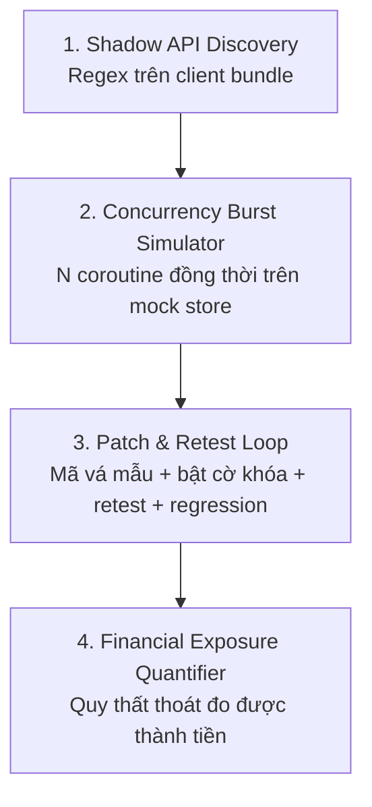

# AIGIS — Adversarial Intelligence for Generative Immunity & Security
> Status: Current · Updated: 2026-11-09 · Scope: Local simulation and read-only data sources
>
> [Mục lục](README.md) · [Backend reliability](backend-reliability.md)

**Đặc tả Kiến trúc Hệ thống (System Architecture & Technical Specification)**

> [!IMPORTANT]
> **Phạm vi:** AIGIS hiện là **proof-of-concept**. Mọi đòn tấn công, bản vá, retest và benchmark đều chạy trên `backend/mock_target/store.py` (một đối tượng Python trong cùng tiến trình) với dữ liệu telemetry giả lập. Mỗi mục bên dưới ghi rõ **đã làm** (code hiện có) và **định hướng** (chưa làm).
>
> * **A** — **A**dversarial *(Tác chiến đối kháng / Red Teaming)*
> * **I** — **I**ntelligence for *(Điều phối đa agent)*
> * **G** — **G**enerative *(Sinh kịch bản tấn công & mã vá mẫu)*
> * **I** — **I**mmunity & *(Vòng lặp vá – kiểm thử lại)*
> * **S** — **S**ecurity *(Bảo vệ logic nghiệp vụ FinTech)*

---

## 1. Vấn đề

### 1.1. Lỗ hổng logic nghiệp vụ (Business Logic Vulnerabilities)
Hệ thống chạy đúng cú pháp nhưng chuỗi hành vi của người dùng phá vỡ mục đích kinh tế:
* **Race condition (TOCTOU):** gửi đồng thời nhiều request nhận quà trước khi hệ thống kịp ghi nhận lượt nhận đầu tiên.
* **State-machine bypass:** gọi thẳng API xác nhận đơn, bỏ qua bước thanh toán hoặc OTP.
* **Parameter tampering:** số âm, số thập phân bất thường trong số tiền.
* **BOLA:** thao tác trên tài khoản không thuộc quyền sở hữu.

### 1.2. Vì sao khó phát hiện
* SAST/DAST chủ yếu tìm mẫu lỗi kỹ thuật đã biết; chúng không biết quy tắc kinh doanh (ví dụ: "mỗi khách chỉ được nhận một voucher").
* Lỗi race condition phụ thuộc thời gian, khó tái hiện bằng kiểm thử tuần tự.
* Pentest thủ công tốn kém và không theo kịp chu kỳ release liên tục.

---

## 2. Bốn thành phần chính



### 2.1. Shadow API Discovery
* **Đã làm:** quét `backend/mock_target/checkout_bundle.js` bằng regex để tìm chuỗi endpoint không có trong tài liệu API (`backend/agents/rea_dissector.py`).
* **Định hướng:** phân tích AST cho JS bundle, hỗ trợ React Native/APK, dựng đồ thị máy trạng thái nghiệp vụ tự động.

### 2.2. Concurrency Burst Simulator
* **Đã làm:** `asyncio.gather` N lời gọi `claim_voucher` vào mock store; đếm số lần nhận trùng (`backend/agents/sandbox_runner.py`). Không có network I/O.
* **Định hướng:** gửi request HTTP/2 đồng thời thật (kỹ thuật single-packet) vào một service mục tiêu riêng biệt, có giới hạn phạm vi và xác nhận quyền kiểm thử.

### 2.3. Patch & Retest Loop
* **Đã làm:**
  * Sinh **mã vá mẫu** cho SQL (ràng buộc UNIQUE + `ON CONFLICT`), FastAPI, Spring, Gin, Cloudflare, NGINX/Lua, AWS WAF (`backend/patch_exporter.py`). Mã mẫu chỉ để review, **không được thực thi**.
  * "Áp bản vá" trên mock target = bật cờ khóa (dict trong bộ nhớ). Retest reset trạng thái và chỉ đạt khi **đúng 1** lượt nhận thành công.
  * Regression check: chạy cùng nhóm người dùng hợp lệ khi tắt/bật bản vá, đo **tỷ lệ chặn nhầm** và **độ trễ tăng thêm** (`backend/agents/blue_aegis.py`). Không có số cứng.
* **Định hướng:** áp bản vá vào service mục tiêu trong container, chạy lại bài tấn công qua mạng.

### 2.4. Financial Exposure Quantifier
$$\text{Thất thoát} = \text{Số lượt nhận trái phép} \times \text{Giá trị voucher}$$
* **Đã làm:** tính trên từng lần chạy (trước vá / sau vá / giữ lại được). Điểm an toàn 0–100 là **heuristic demo**, không phải chứng nhận.
* **Định hướng:** nhân với tần suất tấn công ước tính và ngân sách chiến dịch thực tế để ra con số theo chiến dịch.

---

## 3. Kiến trúc agent

```mermaid
sequenceDiagram
    autonumber
    actor Dev as Lập trình viên / Security Lead
    participant A1 as REA Dissector
    participant A2 as Red Team (Cerebrus)
    participant SB as Sandbox Runner (mock store)
    participant A4 as Blue Team (Aegis)
    participant A5 as Arbiter

    Dev->>A1: Bắt đầu wargame
    A1->>A1: Regex quét client bundle, liệt kê Shadow API
    A1->>A2: Danh sách endpoint nghi vấn
    A2->>SB: N lời gọi đồng thời
    SB-->>A2: Số lượt nhận trùng + thất thoát đo được
    SB->>A4: Kết quả tấn công
    A4->>A4: Sinh mã vá mẫu
    A4->>SB: Bật cờ khóa, retest + regression
    SB-->>A4: Retest: 1 lượt hợp lệ; tỷ lệ chặn nhầm, độ trễ
    A4->>A5: Kết quả
    A5->>Dev: Financial Exposure Dossier + nội dung PR mô phỏng
```

Các agent bổ trợ:
* **FinTech Sentinel** (`fintech_sentinel.py`): theo dõi TPS theo cửa sổ trượt, đạo hàm vận tốc, dự báo tuyến tính; lọc flash sale hợp lệ dựa trên tỷ lệ người dùng khác nhau, tỷ lệ proxy datacenter và khung giờ khuyến mãi.
* **Quant Investigator** (`quant_investigator.py`): RCA bằng SQL tham số hóa, kết nối chỉ đọc; đo khoảng cách giữa các request của cùng người dùng (≤ 50ms = va chạm).
* **SecOps Copilot** (`secops_copilot.py`): hỏi đáp, chuyển tiếp sang Investigator khi cần.
* **Work Order Generator** (`work_order_generator.py`): phiếu thay đổi với kế hoạch canary 3 giai đoạn (chỉ xem trước, không deploy).
* **Traffic Classifier** (`traffic_classifier.py`): heuristic 4 vector (burst, proxy ASN, User-Agent bot, thiếu idempotency key). Không dùng `user_id` hay nhãn `is_attack` làm đặc trưng. Báo cáo precision, recall, FPR, F1 so với nhãn giả lập.

---

## 4. Cấu trúc mã nguồn

```
aigis/
├── backend/
│   ├── server.py                 # FastAPI, token auth, bind 127.0.0.1
│   ├── agents/
│   │   ├── rea_dissector.py      # Regex tìm Shadow API
│   │   ├── red_cerebrus.py       # Burst coroutine (không HTTP)
│   │   ├── sandbox_runner.py     # Chạy kịch bản trên mock store, tính thất thoát
│   │   ├── blue_aegis.py         # Mã vá mẫu + regression check
│   │   ├── arbiter.py            # Điểm heuristic, dossier, PR mô phỏng
│   │   ├── adversarial_trainer.py# Điều phối wargame
│   │   ├── fintech_sentinel.py   # Theo dõi drift TPS
│   │   ├── quant_investigator.py # RCA SQL chỉ đọc
│   │   ├── secops_copilot.py     # Hỏi đáp
│   │   └── work_order_generator.py
│   ├── mock_target/
│   │   ├── store.py              # Mock voucher/ví có lỗi race condition, BOLA
│   │   └── checkout_bundle.js    # Client bundle chứa endpoint ẩn
│   ├── traffic_classifier.py
│   ├── data_simulator.py         # Sinh dữ liệu giả lập 1 triệu dòng
│   └── ...
├── frontend/index.html           # Dashboard một trang
└── tests/test_security_regressions.py
```

---

## 5. Lộ trình

| Hạng mục | Trạng thái |
| :--- | :--- |
| Mock target + vòng lặp tấn công / vá / retest | Đã làm |
| Mã vá mẫu đa nền tảng | Đã làm (không thực thi) |
| Regression check (chặn nhầm, độ trễ) | Đã làm (trên mock) |
| Precision / recall / FPR cho bộ phân loại | Đã làm (trên dữ liệu giả lập) |
| HTTP đồng thời thật vào service mục tiêu | Chưa |
| Phân tích AST / APK | Chưa |
| Tạo PR thật qua GitHub API | Chưa |
| Tỷ lệ gian lận và giá trị giao dịch sát thực tế | Chưa |
| Kịch bản gian lận ngân hàng (thử thẻ, ATO, tài khoản mule) | Chưa |

## 6. Evidence, isolation và replay

### 6.1. Nguồn gốc và mức độ kết luận

`backend/evidence.py` định nghĩa context bất biến cho dataset, phân tích và mô phỏng:

- **Dataset:** đường dẫn chuẩn hóa, `dataset_id` và `dataset_revision` dựa trên metadata file/WAL. Revision dùng để vô hiệu hóa cache, không phải hash toàn bộ nội dung.
- **Analysis:** endpoint, mốc đầu/cuối cửa sổ, số bản ghi, nguồn và độ đầy đủ. Các truy vấn liên quan dùng cùng read snapshot; thay đổi revision được đánh dấu stale.
- **Simulation:** `run_id`, scenario, `workload_id`, phase, seed và cấu hình control. Attack/retest phải khớp scenario, workload và provenance để được chấm như một cặp trước/sau.

| Assessment state | Ý nghĩa |
| :--- | :--- |
| `NOT_ASSESSED` | Chưa đánh giá |
| `INSUFFICIENT_DATA` | Không đủ dữ liệu để kết luận |
| `NO_SIGNAL_OBSERVED` | Không thấy tín hiệu trong phạm vi quan sát; không chứng minh hệ thống an toàn |
| `SIGNAL_DETECTED` | Có tín hiệu telemetry; chưa chứng minh khai thác được lỗi isolation |
| `EXPLOIT_REPRODUCED_IN_MOCK` | Tái hiện khai thác trên mock target |
| `MITIGATION_VERIFIED_IN_MOCK` | Control đạt kiểm tra trên workload mock tương ứng |
| `VERIFICATION_FAILED` | Kiểm tra không đạt |

`UNSUPPORTED_DATASET` là trạng thái tương thích schema của diagnosis, không phải một assessment state. Copilot hiển thị số liệu không khả dụng thay vì tự điền khi dataset không hỗ trợ.

### 6.2. Vòng đời và cô lập mô phỏng

`backend/simulation.py` dùng `ContextVar` để cấp mock store riêng cho mỗi full workflow/training. Khi hoàn tất, lỗi hoặc hủy, context được khôi phục. Các round lưu từng cặp attack/retest và dossier; `dossier` tương thích là round cuối, `training_summary` chứa tổng hợp toàn bộ round.

UI gửi `X-AIGIS-Wargame-Session` để cô lập mock store/trạng thái từng tab; session hết hạn sau một giờ, tối đa 100 session. Caller không gửi header vẫn dùng session chia sẻ được tuần tự hóa; dùng một API worker cho luồng legacy này. Session từng bước ở RAM, không phải durable job.

`backend/job_queue.py` lưu job trong SQLite: nhận job nguyên tử, tối đa 20 job chờ/đang chạy và một durable job hoạt động. Worker thuộc lifespan ứng dụng, kiểm tra cancel/heartbeat và deadline 120 giây. Lease quá 10 giây được đánh dấu `INTERRUPTED` hoặc `TIMED_OUT` khi worker claim tiếp theo; không tự retry. Các route đồng bộ cũ không chịu giới hạn của queue. Xem [chi tiết vòng đời](wargame-improvements.md#durable-execution-and-replay).

### 6.3. Lưu trữ và tái hiện

`backend/run_store.py` lưu cấu hình/kết quả training và HTTP multi-cycle recheck vào `backend/datasets/aigis_runs.db`, độc lập với telemetry database đang chọn. Có thể đổi đường dẫn bằng `AIGIS_RUN_DB`.

| Route | Method | Mục đích |
| :--- | :---: | :--- |
| `/api/v1/wargame/run_full` | POST | Chạy full workflow; nhận `rounds`, `burst_streams`, `seed` |
| `/api/v1/wargame/train` | POST | Training nhiều round, hỗ trợ seed |
| `/api/v1/wargame/recheck_multicycle` | POST | Kiểm tra nhiều cycle và lưu manifest |
| `/api/v1/wargame/runs/{run_id}` | GET | Đọc cấu hình và evidence đã lưu |
| `/api/v1/wargame/runs/{run_id}/replay` | POST | Chạy manifest training tương thích hoặc cấu hình recheck, tạo run mới |
| `/api/v1/wargame/jobs` | POST | Tạo durable job, trả 202 |
| `/api/v1/wargame/jobs/{run_id}` | GET | Đọc trạng thái job và run |
| `/api/v1/wargame/jobs/{run_id}/cancel` | POST | Yêu cầu hủy job |

Training lưu manifest v3 trước/sau theo cùng workload; replay đọc trực tiếp manifest đã lưu, kiểm tra hash, schema/scenario/control và hash source code. Run v2 còn đọc được nhưng không replay trên v3. Seed thay đổi lịch voucher, thứ tự fixture BOLA/tamper và ID đơn hàng tổng hợp; giá trị tiền và chuỗi trạng thái vẫn là fixture chuẩn. Không đảm bảo latency giống hệt. Recheck dùng cấu hình/control/seed đã lưu, không áp dụng hợp đồng manifest training. Chi tiết xem [Backend reliability](backend-reliability.md).

## 7. PostgreSQL như nguồn dữ liệu chỉ đọc

```text
Server environment profile → psycopg read-only transaction
  → schema/table discovery → bounded table snapshot
  → backend/datasets/uploads/postgres_<id>.db
  → existing SQLite dashboard / classifier / SQL analysis
```

`backend/postgres_source.py` dùng driver tùy chọn `psycopg`, profile `AIGIS_POSTGRES_<NAME>` chỉ nằm ở server, identifier được quote bằng driver và giá trị được parameterize. Không nhận DSN/password từ trình duyệt, không chạy SQL console trên remote. Connection timeout 5s, statement timeout 10s và lock timeout 2s; role chỉ đọc và TLS do người vận hành cấu hình.

Giới hạn: 500 bảng trong discovery, 200 cột, 100.000 dòng và 50 MiB dữ liệu chuyển đổi. Snapshot theo scan order, không hứa là bản ghi mới nhất; refresh thủ công, lỗi giữ dataset cũ. Metadata nguồn ở RAM; file snapshot tồn tại sau restart nhưng provenance PostgreSQL không tự phục hồi. Dataset active vẫn dùng chung toàn ứng dụng. Stream mô phỏng, run history và queue vẫn ở SQLite. Xem [cài đặt và giới hạn](postgresql.md).
