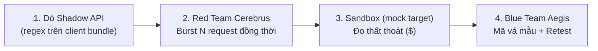

# AIGIS — Bản Tóm Tắt Dự Án (One-Pager)
> Status: Current · Updated: 2026-11-09 · Scope: Local simulation and read-only data sources
>
> [Mục lục](README.md) · [Kiến trúc](architecture.md) · [Demo](demo.md)

**AIGIS: Adversarial Intelligence for Generative Immunity & Security**

> [!IMPORTANT]
> **Phạm vi:** AIGIS là **proof-of-concept (bản mô phỏng)**. Mọi đòn tấn công, bản vá và kiểm thử lại đều chạy trên **mock target trong cùng tiến trình** (`backend/mock_target/store.py`). Telemetry có thể là dữ liệu tổng hợp, file được phép sử dụng hoặc snapshot PostgreSQL chỉ đọc; kết nối nguồn dữ liệu không có nghĩa là kiểm thử tấn công/deploy bản vá lên hệ thống thật. Chi tiết giới hạn xem [README](../README.md) mục *Scope & limitations*.

> **Tên gọi:**
> * **A** — **A**dversarial *(Tác chiến đối kháng / Red Teaming)*
> * **I** — **I**ntelligence for *(Điều phối đa agent)*
> * **G** — **G**enerative *(Sinh kịch bản tấn công & mã vá mẫu)*
> * **I** — **I**mmunity & *(Vòng lặp vá – kiểm thử lại)*
> * **S** — **S**ecurity *(Bảo vệ logic nghiệp vụ FinTech)*
>
> **Pitch 30 giây:**
> *"Kẻ gian trong FinTech và TMĐT không cần hack server — họ khai thác **logic nghiệp vụ**: gửi nhiều request nhận voucher cùng lúc để nhận nhiều lần (race condition), hoặc tìm endpoint ẩn trong mã client. Công cụ SAST/DAST thông thường khó phát hiện loại lỗi theo thời gian này. **AIGIS** mô phỏng một đấu trường: Red Team AI tấn công một hệ thống mẫu, đo số tiền thất thoát, Blue Team AI đề xuất mã vá, sau đó kiểm thử lại để chứng minh lỗi đã được chặn — và quy đổi rủi ro thành số tiền để lãnh đạo dễ ra quyết định."*

---

## 1. Vòng lặp 4 bước (The Wargame Loop)

1. **Dò Shadow API:** Quét file `checkout_bundle.js` bằng regex để tìm endpoint không có trong tài liệu API.
2. **Red Team burst:** Agent *Cerebrus* chạy N lời gọi đồng thời (`asyncio.gather`) vào mock store để tái hiện race condition. Không gửi HTTP thật.
3. **Sandbox & đo thất thoát:** Đếm số lần nhận voucher trùng và quy ra số tiền bị chiếm. Ví dụ nếu 15 lượt cùng thành công, mỗi voucher $500 và 1 lượt là hợp lệ: tổng tiền được duyệt là $7,500, nhưng **thất thoát do nhận trùng là 14 × $500 = $7,000** trên mock target.
4. **Blue Team vá & kiểm thử lại:** Agent *Aegis* sinh **mã vá mẫu** (SQL atomic claim, FastAPI, Spring, Gin, WAF). Trên mock target, "áp bản vá" là bật cờ khóa; bài retest chỉ đạt khi **đúng 1** lần nhận thành công. Bài kiểm tra regression đo tỷ lệ chặn nhầm và độ trễ tăng thêm trên chính mock target.

---

## 2. Các agent trong AIGIS

| Agent | Vai trò | Thực tế trong code |
| :--- | :--- | :--- |
| **REA Dissector** | Tìm Shadow API trong mã client | Regex, không phân tích AST/APK |
| **Red Team "Cerebrus"** | Tái hiện race condition | Coroutine đồng thời, không có network I/O |
| **Sandbox Runner** | Chạy kịch bản, tính thất thoát | Mock store trong bộ nhớ |
| **Blue Team "Aegis"** | Đề xuất mã vá, chạy regression | Mã vá chỉ để hiển thị, không được thực thi |
| **Arbiter** | Điểm an toàn, báo cáo tài chính, nội dung PR | Điểm là heuristic demo; PR là **mô phỏng** (không gọi GitHub) |

Ngoài ra: **FinTech Sentinel** (theo dõi TPS, lọc flash sale hợp lệ), **Quant Investigator** (RCA bằng SQL chỉ đọc), **Traffic Classifier** (phân loại heuristic, có báo cáo precision/recall trên dữ liệu giả lập).

---

## 3. Kịch bản demo 3 phút

* **0:00 – 0:30 (Mở đầu):** Nêu vấn đề lỗi logic nghiệp vụ khiến ngân sách khuyến mãi bị rút. Nói rõ: *"Đây là bản mô phỏng trên hệ thống mẫu."*
* **0:30 – 1:30 (Red Team):** Bấm **Start Wargame** → REA tìm endpoint ẩn → Cerebrus bắn 15 lời gọi đồng thời → mock target ghi nhận nhiều lần nhận voucher trái phép và số tiền thất thoát.
* **1:30 – 2:30 (Blue Team):** Aegis hiển thị mã vá mẫu → bật bản vá trên mock target → retest: chỉ 1 request hợp lệ được duyệt, các request trùng bị chặn (`429`) → regression: hiển thị tỷ lệ chặn nhầm và độ trễ tăng thêm **đo được** trên mock.
* **2:30 – 3:00 (Báo cáo):** Mở **Financial Exposure Dossier**: thất thoát trước/sau vá, điểm an toàn heuristic, nội dung PR mô phỏng. Kết bằng hướng phát triển: trỏ vào API thật, thêm kịch bản gian lận ngân hàng.

---

## 4. Trạng thái hiện tại

- [x] Mock target có endpoint `/api/v1/voucher/claim` dính race condition và `checkout_bundle.js` chứa endpoint ẩn.
- [x] Dò Shadow API (regex) và burst đồng thời trên mock store.
- [x] Đo thất thoát, retest sau vá, regression check (tỷ lệ chặn nhầm, độ trễ).
- [x] Mã vá mẫu đa nền tảng (SQL, FastAPI, Spring, Gin, Cloudflare, NGINX, AWS WAF) — không thực thi.
- [x] Dashboard một trang (`frontend/index.html`), Copilot hỏi đáp, NL-to-SQL, bộ phân loại traffic.
- [x] API có token, chỉ bind `127.0.0.1`, có bộ test hồi quy bảo mật.
- [x] Evidence gắn với dataset/run; full workflow có mock store riêng, seed, lưu kết quả và replay. Xem [kiến trúc](architecture.md#6-evidence-isolation-và-replay).
- [x] Durable benchmark queue, Cancel, heartbeat/lease và timeout; replay trực tiếp manifest training v3 tương thích. Xem [wargame](wargame-improvements.md).
- [x] Nguồn [PostgreSQL chỉ đọc](postgresql.md): chọn schema/table và nhập snapshot có giới hạn để phân tích SQLite; không phải live synchronization.
- [x] Temporal shadow theo yêu cầu, không tự chặn; fixture đánh giá công khai giới hạn false positive và low-rate/distributed signals.
- [ ] Gửi HTTP đồng thời thật vào một service mục tiêu riêng.
- [ ] Tạo PR thật qua GitHub API.
- [ ] Dữ liệu và tỷ lệ gian lận sát thực tế ngân hàng.
